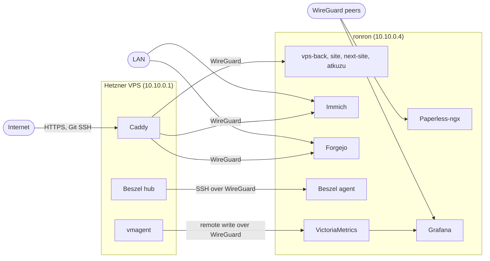

# ronron-docker

The Docker Compose stack of ronron, my home server (Debian, x86_64, Intel iGPU). ronron runs my self-hosted apps, the monitoring of my servers, and the apps behind my public sites.

This repository shows my setup. It is not a template: it depends on my servers, my domains and files that are not in git.

## Architecture

A Hetzner VPS is the public entry. Its Caddy sends each public name to a port of ronron, over WireGuard (`wg0`). The VPS also runs the Beszel hub and vmagent, which collect the stats and the metrics of the servers ([hetzner-docker](https://git.tomplanche.com/tom/hetzner-docker)).

## Services

| Service | Role | Access |
|---------|------|--------|
| [Immich](https://immich.app) | The photo and video library. | Public, through the VPS. LAN. |
| [Paperless-ngx](https://docs.paperless-ngx.com) | The document archive. | WireGuard only. |
| [Forgejo](https://forgejo.org) | The git server ([git.tomplanche.com](https://git.tomplanche.com)), with my theme. | Public, through the VPS (web and SSH). LAN. |
| [Beszel](https://beszel.dev) agent | Sends the CPU, RAM, disk, network, temperature, GPU and container stats of ronron to the Beszel hub. | WireGuard only. |
| [VictoriaMetrics](https://victoriametrics.com) | Stores the metrics that vmagent sends, for 1 year. | WireGuard only. |
| [Grafana](https://grafana.com) | Shows the metrics. | WireGuard only. |
| [vps-back](https://github.com/TomPlanche/vps-back) | My API (Rust, axum). | `api.tomplanche.com`, `tomplanche.com/api/` |
| [site](https://github.com/TomPlanche/portfolio-v222) | My portfolio (SvelteKit), branch `main`. | `tomplanche.com` |
| [next-site](https://github.com/TomPlanche/portfolio-v222) | The same portfolio, branch `next`. | `next.tomplanche.com` |
| [atkuzu](https://tangled.org/tomplanche.com/atkuzu) | A Takuzu game with a daily puzzle (SvelteKit, SQLite, atproto OAuth). | `atkuzu.tomplanche.com` |
| atkuzu-daily | A job that writes the daily puzzles of atkuzu. Cron runs it every hour. | None. |

Immich also runs its machine learning container, a Valkey and a Postgres. Paperless also runs a Redis.

## Design

### Network

- The ports listen on the WireGuard address `10.10.0.4` only. Immich and Forgejo are the exceptions: they also serve the LAN, so they listen on `0.0.0.0`.
- The `0.0.0.0` ports are IPv4 only. Docker goes around ufw, and a port without an address also listens on IPv6.
- Docker starts after WireGuard (a systemd drop-in in `host/`), so the containers can listen on `10.10.0.4`.
- Each app has its own Docker network. The containers of one app cannot reach the containers of another app.

### Images

- The upstream images have a fixed version. The Postgres and the Valkey of Immich also have a digest, as in the compose file of Immich.
- ronron builds the images of my apps from their sources, with the Dockerfiles of `images/`. A new commit of an app needs no change in this repository: `just ship <service>` gets the sources and builds the image again.
- Before each build, `just ship` tags the current image as `<image>-previous`. A rollback is one `docker tag`.

### Hardware

- Immich transcodes the videos with Quick Sync and runs its machine learning with OpenVINO, both on the Intel iGPU.
- The Beszel agent reads the load of the iGPU with `intel_gpu_top`.

### Monitoring

- Beszel shows the resources of each server. The hub on the VPS connects to the agent on ronron with SSH.
- vmagent on the VPS sends the metrics of the sites to VictoriaMetrics: the requests, the status codes, the durations and the CrowdSec bans. If ronron does not answer, vmagent keeps the metrics on its disk and sends them later.
- The data source and the dashboards of Grafana are files in `grafana/`, so git keeps each change.

### Backups

- `host/ronron-backup` runs every night from a systemd timer. It saves `data/` and `env/` with restic, to a second disk. Then it copies the new snapshots to a second restic repository, on a Hetzner Storage Box, outside the house.
- So the backups follow the 3-2-1 rule: 3 copies of the data (the server, the backup disk, the Storage Box), on 2 different storage media, with 1 copy outside the house. The offsite repository has its own password.
- The script stops Forgejo, Paperless, Grafana and atkuzu during their snapshot, so that their SQLite databases stay consistent. It starts them again, also after an error.
- The script does not copy the files of the running Postgres. Immich writes its own database dumps every night, and the backup saves them with the library.
- The script keeps 7 daily, 4 weekly and 6 monthly snapshots in each repository. Then it reads 1 % of the local data and 500 MiB of the offsite data again, to check the two repositories.
- At the end, the script sends a heartbeat to Uptime Kuma. If a step fails, the offsite copy included, the heartbeat does not come, and Kuma sends an alert.

### Fonts

The fonts of the site and of the Forgejo theme have a license that does not allow them in a public repository or a public image. Git ignores them, and the containers mount them at start-up. Without them, the pages use fallback fonts.

### Local test

`compose.local.yaml` changes the stack for a local machine: test env files, ports on `127.0.0.1`, no GPU. `just local-up` and `just local-test` start and check the full stack before each deploy.

## Layout

| Path | Content |
|------|---------|
| `compose.yaml` | The production stack. |
| `compose.local.yaml` | The changes for the local test. |
| `justfile` | All the commands. `just` lists them. |
| `images/` | One Dockerfile for each of my apps. |
| `scripts/` | The scripts that clone the sources of the apps, build their images and ship them. |
| `forgejo/` | A git submodule: [tom/forgejo](https://git.tomplanche.com/tom/forgejo), the theme and the templates of Forgejo. |
| `grafana/` | The data source and the dashboards of Grafana. |
| `host/` | The files for the host: the systemd drop-in of Docker, the backup script and its units. |
| `env/*.env.example` | The keys of each env file. The real env files are not in git. |

`data/` (the data of the services) and `src/` (the sources of the apps) are not in git.

## Related repositories

- [hetzner-docker](https://git.tomplanche.com/tom/hetzner-docker): the stack of the VPS: the sites of Caddy, the Beszel hub and vmagent.
- [tom/forgejo](https://git.tomplanche.com/tom/forgejo): the theme of Forgejo.
- [vps-back](https://github.com/TomPlanche/vps-back), [portfolio-v222](https://github.com/TomPlanche/portfolio-v222), [atkuzu](https://tangled.org/tomplanche.com/atkuzu): the apps.
